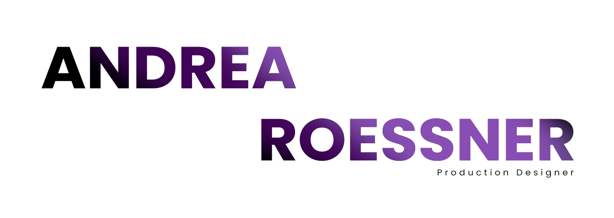

<div align="center">



### Portfolio site — art director / production designer

[](https://andrearoessner.com)
[](https://roifuries.github.io/AndreaRoessnerPortfolio/)
[](#)
[](#)
[](#)

[](#)
[](#)
[](#)
[](#)

**English** · [Español ↓](#que-es-esto)

</div>

| Credits | |
| --- | --- |
| 🎨 Design & development | **Roi Furies** |
| 🌐 Web | [rmqz.mx](https://rmqz.mx/) |
| ✉️ Email | [hola@rmqz.mx](mailto:hola@rmqz.mx) |
| 📷 Instagram (design) | [@roifuries2](https://www.instagram.com/roifuries2/) |
| 📷 Instagram (personal) | [@roifuries](https://www.instagram.com/roifuries/) |

---

## ✨ What this is

**Andrea Roessner** is a production designer based in Mexico, with extensive
experience in commercials, music videos, and stage design. This site is her
portfolio: a space to showcase her work.

Animated home with a hover effect that changes the background by category,
project grids (Commercials, Fiction & Music Video, Stage Design), a detail
page with a photo carousel or Vimeo video depending on the project, and a
contact page — all in **Spanish, English, and German**.

Plain HTML, CSS, and JavaScript, **no build step, no dependencies**. Served
as-is from any static hosting.

```bash
python3 -m http.server 8000
# open http://localhost:8000
```

---

## 🧭 Project map

<details>
<summary><strong>Pages</strong></summary>

| Page | What it does |
| --- | --- |
| `index.html` | Home — animated hero, hover changes the background by category |
| `comerciales.html` | Commercials grid |
| `videoclips.html` | Fiction & Music Video grid |
| `escenografias.html` | Stage Design grid |
| `proyectos/template.html?p=<slug>` | Project detail — dynamic, reads the slug from the URL |
| `contacto.html` | Contact |

</details>

<details>
<summary><strong>JavaScript</strong></summary>

| File | What it does |
| --- | --- |
| `js/data.js` | 📋 Every project (title, Vimeo, credits, gallery) — the only file you edit to add/remove/reorder projects |
| `js/i18n.js` | 🌐 Embedded ES/EN/DE dictionary + language switcher |
| `js/partials.js` | 🧩 Builds the nav and footer on every page |
| `js/category.js` | 🖼️ Category project grid (video or photo depending on whether it has a `videoId`) |
| `js/detail.js` | 🎬 Project detail — hero (video or photo carousel), gallery, slideshow-style lightbox |
| `js/home.js` | 🏠 Home hero hover, animations |
| `js/contact.js` | ✉️ Contact page logic |

</details>

<details>
<summary><strong>Styles and assets</strong></summary>

| Path | What it does |
| --- | --- |
| `css/style.css` | All styles — color/typography tokens at the top of the file |
| `assets/` | Home backgrounds and fonts |
| `assets/img/Comerciales/<slug>/` | Gallery photos — Commercials |
| `assets/img/FiccionVideoClips/<slug>/` | Gallery photos — Fiction & Music Video |
| `assets/img/Escenografias/<slug>/` | Gallery photos — Stage Design |

</details>

---

## ➕ How to add a project

A single file, `js/data.js`. Every project is an object in `window.PROJECTS`:

```js
{
  slug: 'my-project',           // unique, no spaces or accents — used in the URL
  title: 'My Project',
  videoId: '123456789',         // Vimeo ID — empty/omitted = no video, the hero
                                 // shows a photo carousel instead
  director: 'Name',             // optional
  dop: 'Name',                  // director of photography — optional
  productora: 'Name',           // fallback for dop when there's no DOP (e.g. documentaries)
  song: 'Song name',            // music videos only — optional
  category: 'commercials',      // 'commercials' | 'videoclips' | 'stagedesign'
  gallery: ['photo1.jpg', 'photo2.jpg']   // optional — without it, no carousel
}
```

Photos go in `assets/img/<CategoryFolder>/<slug>/`, where `<CategoryFolder>`
is `Comerciales`, `FiccionVideoClips`, or `Escenografias` depending on the
category. Without `gallery`, the carousel simply doesn't show — nothing to
delete by hand.

> ⚠️ Filenames are case-sensitive in production (GitHub Pages) even though
> they aren't on Mac/Windows. If a photo only fails to load there, this is
> almost always why.

---

## 🌍 Languages

Custom translation engine, no dependencies, no `fetch` — works even when
opening the files directly (`file://`). Dictionary embedded in `js/i18n.js`.
The EN/DE translations were drafted with AI help, not by a native
translator — worth a native review before fully trusting them, German
especially.

---

<div align="center">

English · **[↑ Español](#)**

</div>

<a id="que-es-esto"></a>

## ✨ Qué es esto

**Andrea Roessner** es diseñadora de producción, basada en México, con una
amplia trayectoria en comerciales, videoclips y escenografía. Este sitio es
su portafolio: un espacio para mostrar su trabajo.

Home animado con hover que cambia el fondo por categoría, grids de proyectos
(Comerciales, Ficción & Videoclips, Escenografías), página de detalle con
carrusel de fotos o video de Vimeo según el proyecto, y contacto — todo en
**español, inglés y alemán**.

HTML, CSS y JavaScript planos, **sin build step ni dependencias**. Se sirve
tal cual desde cualquier hosting estático.

```bash
python3 -m http.server 8000
# abrir http://localhost:8000
```

---

## 🧭 Mapa del proyecto

<details>
<summary><strong>Páginas</strong></summary>

| Página | Qué hace |
| --- | --- |
| `index.html` | Home — hero animado, hover que cambia el fondo por categoría |
| `comerciales.html` | Grid de Comerciales |
| `videoclips.html` | Grid de Ficción & Videoclips |
| `escenografias.html` | Grid de Escenografías |
| `proyectos/template.html?p=<slug>` | Detalle de proyecto — dinámico, lee el slug de la URL |
| `contacto.html` | Contacto |

</details>

<details>
<summary><strong>JavaScript</strong></summary>

| Archivo | Qué hace |
| --- | --- |
| `js/data.js` | 📋 Todos los proyectos (título, Vimeo, créditos, galería) — el único archivo que se edita para agregar/quitar/reordenar proyectos |
| `js/i18n.js` | 🌐 Diccionario ES/EN/DE embebido + switcher de idioma |
| `js/partials.js` | 🧩 Genera nav y footer en cada página |
| `js/category.js` | 🖼️ Grid de proyectos por categoría (video o foto según tenga `videoId`) |
| `js/detail.js` | 🎬 Detalle de proyecto — hero (video o carrusel de fotos), galería, lightbox tipo slideshow |
| `js/home.js` | 🏠 Hover del hero, animaciones del home |
| `js/contact.js` | ✉️ Lógica de la página de contacto |

</details>

<details>
<summary><strong>Estilos y assets</strong></summary>

| Ruta | Qué hace |
| --- | --- |
| `css/style.css` | Todos los estilos — tokens de color/tipografía al inicio del archivo |
| `assets/` | Fondos del home y fuentes |
| `assets/img/Comerciales/<slug>/` | Fotos de galería — Comerciales |
| `assets/img/FiccionVideoClips/<slug>/` | Fotos de galería — Ficción & Videoclips |
| `assets/img/Escenografias/<slug>/` | Fotos de galería — Escenografías |

</details>

---

## ➕ Cómo agregar un proyecto

Un solo archivo, `js/data.js`. Cada proyecto es un objeto en `window.PROJECTS`:

```js
{
  slug: 'mi-proyecto',          // único, sin espacios ni acentos — se usa en la URL
  title: 'Mi Proyecto',
  videoId: '123456789',         // ID de Vimeo — vacío/omitido = sin video, el hero
                                 // muestra un carrusel de fotos en su lugar
  director: 'Nombre',           // opcional
  dop: 'Nombre',                // director de fotografía — opcional
  productora: 'Nombre',         // fallback de dop cuando no hay DOP (ej. documentales)
  song: 'Nombre de canción',    // solo videoclips — opcional
  category: 'commercials',      // 'commercials' | 'videoclips' | 'stagedesign'
  gallery: ['foto1.jpg', 'foto2.jpg']   // opcional — sin esto, no hay carrusel
}
```

Las fotos van en `assets/img/<CategoriaCarpeta>/<slug>/`, donde
`<CategoriaCarpeta>` es `Comerciales`, `FiccionVideoClips` o `Escenografias`
según la categoría. Sin `gallery`, el carrusel simplemente no aparece — no
hay que borrar nada a mano.

> ⚠️ Los nombres de archivo distinguen mayúsculas/minúsculas en producción
> (GitHub Pages) aunque no en Mac/Windows. Si una foto no carga solo ahí, es
> casi siempre por esto.

---

## 🌍 Idiomas

Motor de traducción propio, sin dependencias ni `fetch` — funciona incluso
abriendo los archivos directo (`file://`). Diccionario embebido en
`js/i18n.js`. Las traducciones EN/DE fueron redactadas con ayuda de IA, no
por un traductor nativo — vale la pena una revisión antes de confiar en ellas
al 100%, sobre todo el alemán.

---

<div align="center">

Made with love by **Roi Furies**

[](https://rmqz.mx/)
[](mailto:hola@rmqz.mx)
[-%40roifuries2-E4405F?style=flat-square&logo=instagram&logoColor=white)](https://www.instagram.com/roifuries2/)
[-%40roifuries-E4405F?style=flat-square&logo=instagram&logoColor=white)](https://www.instagram.com/roifuries/)

</div>
